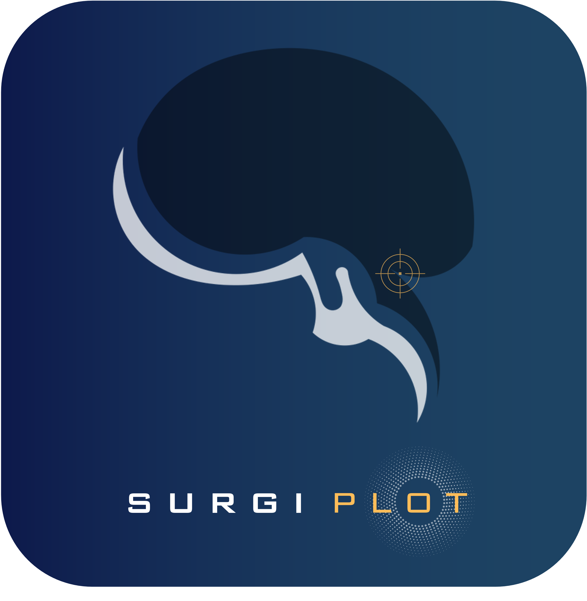

<p align="center">
  
</p>

<p align="center">
  
</p>

# Surgiplot

[](https://github.com/LeonardT-MD/Surgiplot/actions/workflows/ci.yml)
[](LICENSE)

Surgiplot is a coordinate-native research software package for quantitative neurosurgical anatomy. It converts named three-dimensional landmarks into inspectable morphometric constructs through one shared Python computation core, exposed through a command-line interface and a desktop graphical interface.

The software is designed for reproducible anatomical research. It is not a medical device, does not provide clinical recommendations, and has not been validated for autonomous diagnosis, treatment selection, or intraoperative navigation.

**New users:** follow the [complete Getting Started guide](docs/GETTING_STARTED.md) for installation, terminal syntax, a synthetic worked example, every metric family, the desktop workflow, and Python use.

## Repository scope

This repository contains the standalone Surgiplot software:

- the `surgiplot` Python package;
- dataset normalization and neuronavigation import;
- the public Python API;
- the `surgiplot` command-line interface;
- the `surgiplot-gui` desktop application;
- optional rendered-scene landmark acquisition;
- metric, provenance, comparison, and repeatability logic;
- automated numerical and I/O regression tests;
- technical, user, and publication documentation.

The 3D Slicer integration is maintained separately as [SurgiplotToolkit](https://github.com/LeonardT-MD/SurgiplotToolkit). Segmentation models and model weights are not part of this repository.

## Metric nomenclature

The following names are used consistently in code and documentation:

| Identifier | Name | Primary output |
|---|---|---:|
| `DISTANCE_3D` | three-dimensional Euclidean distance | mm |
| `AREA_3D` | best-fit-plane polygon area | mm² |
| `VOLUME_3D` | sparse-point enclosed-volume estimate | mm³ |
| `AOE` / AoE | principal included Angle of Exposure | degrees |
| `AOA_SF` / AoA | Angle of Attack | degrees |
| `AOA_SF` / SF | Surgical Freedom | mm² |
| `VOM_VOA` / VOM | Volume of Operative Maneuverability | mm³ |
| `VOM_VOA` / sVOM | standardized Volume of Operative Maneuverability | mm³ |
| `VOM_VOA` / VoA | Visuo-operative Angle | degrees |

The software’s three-point AoE implementation returns the principal angle in `[0°, 180°]`. It must not be represented as a reflex-angle or full circular Angle of Exposure method. The exact mathematical contract for every metric is documented in [Metric Reference](docs/METRICS_REFERENCE.md).

## Architecture

```text
input file or numeric coordinates
             │
             ▼
       Dataset normalization
   names · aliases · metadata · provenance
             │
             ▼
      shared metric functions
 distance · area · volume · AoE · AoA/SF · VOM/sVOM/VoA
             │
       ┌─────┴──────────┐
       ▼                ▼
 Python API        CLI / desktop GUI
       │                │
       └──────┬─────────┘
              ▼
 scalar results · debug geometry · normalized datasets · study tables
```

All interfaces call the same functions under `surgiplot/metrics`. The GUI is an acquisition and visualization layer; it does not contain a second numerical implementation.

## Requirements

- Python 3.10 or newer;
- a supported desktop operating system for the optional GUI;
- no network connection for ordinary metric computation;
- input coordinates expressed in one consistent spatial frame.

Coordinate units are not inferred from values. The software reports `mm`, `mm²`, and `mm³` under the explicit assumption that input coordinates are in millimeters.

## Installation

### Core, Python API, and CLI

```bash
git clone https://github.com/LeonardT-MD/Surgiplot.git
cd Surgiplot
python3 -m venv .venv
source .venv/bin/activate          # Windows: .venv\Scripts\activate
python -m pip install --upgrade pip
python -m pip install .
```

### Desktop GUI

```bash
python -m pip install '.[gui]'
surgiplot-gui
```

The legacy command name `surgiplot_gui` remains available.

### GUI with PyVista/VTK rendered-scene support

```bash
python -m pip install '.[scene3d]'
surgiplot-gui
```

### Conda-assisted installation

Run from the cloned repository root:

```bash
bash surgiplot/scripts/install_conda.sh surgiplot
conda activate surgiplot
surgiplot version
```

Alternatively, from the repository root:

```bash
conda env create -f surgiplot/env/surgiplot_master.yml
conda activate surgiplot
```

See [Installation and Deployment](docs/INSTALLATION.md) for platform notes, editable development installs, troubleshooting, and uninstall instructions.

## Installation verification

```bash
surgiplot version
surgiplot --help
python -c "import surgiplot; print(surgiplot.__version__)"
```

Expected version for this source line: `0.3.0`.

Developers should additionally run:

```bash
python -m pytest
ruff check surgiplot tests
```

## Input data

Surgiplot accepts:

- normalized CSV, TSV, XLSX, and Surgiplot JSON datasets;
- Stryker annotation-point text exports;
- Medtronic JSON annotations and plans;
- generic text point lists;
- arrays supplied directly through Python;
- landmarks committed from the optional rendered-scene workspace.

A normalized delimited table uses these required columns:

```text
name,x,y,z
cranial,12.5,-4.2,31.0
caudal,12.1,-9.8,29.7
```

An optional `labels` column contains comma-separated aliases. JSON, CSV, and TSV exports are loadable again, preserving the point dataset’s public semantics. Full schemas and vendor behavior are documented in [Data Formats and Coordinate Semantics](docs/DATA_FORMATS.md).

Do not commit patient datasets, DICOM studies, scene files, screenshots containing identifiers, or derived tables containing protected health information.

## CLI quick start

Inspect a dataset:

```bash
surgiplot dataset summary points.csv
surgiplot dataset labels points.csv
surgiplot dataset export points.csv normalized.json
```

Compute a distance:

```bash
surgiplot metric distance points.csv --A point_1 --B point_2
```

Compute polygon area with compact range syntax:

```bash
surgiplot metric area points.csv --polygon point_1-4
```

Compute Angle of Attack and Surgical Freedom:

```bash
surgiplot metric aoa-sf points.csv \
  --cranial cranial \
  --caudal caudal \
  --medial medial \
  --lateral lateral \
  --pivot target \
  --sf-rescale-radius-mm 10
```

Compute VOM, sVOM, and VoA:

```bash
surgiplot metric vom-voa points.csv \
  --entry entry_1-4 \
  --target target_1-4 \
  --stand-dist 10
```

Metric commands emit JSON to standard output so results can be redirected or parsed by another program. See the complete [CLI Reference](docs/CLI_REFERENCE.md).

## Python quick start

```python
import surgiplot as sp

dataset = sp.load("points.csv", kind="database")

distance = sp.DISTANCE_3D(data=dataset, A="point_1", B="point_2")
area = dataset.AREA_3D(polygon="point_1-4")

aoa_sf = sp.AOA_SF(
    data=dataset,
    entry=["cranial", "caudal", "medial", "lateral"],
    target="pivot",
    sf_rescale_radius_mm=10.0,
    return_debug=True,
)

corridor = sp.VOM_VOA(
    data=dataset,
    entry="entry_1-4",
    target="target_1-4",
    stand_dist=10.0,
    return_debug=True,
)
```

Metric functions return dataclasses with typed scalar fields and an optional `debug` dictionary containing the geometry used for verification and plotting. See [Python API](docs/PYTHON_API.md).

## Numerical behavior and validation

The release tests cover:

- known analytical distance, area, angle, tetrahedral volume, SF, VOM, and sVOM fixtures;
- rigid-translation invariance, including coordinates offset by millions of units;
- rejection of non-finite, duplicate, collinear, zero-length, and role-incomplete geometry;
- normalized JSON/CSV/TSV round trips;
- Stryker and Medtronic parser detection;
- CLI JSON output and point-range expansion;
- repeatability statistics and non-finite-value filtering.

The VOM mesh-volume calculation is evaluated in a local numerical frame to avoid origin-dependent cancellation. Polygon metrics require explicit vertex order. Sparse volume reconstruction reports either `alpha_shape_auto` or `convex_hull` in debug output; downstream analyses should retain this method field.

See [Validation and Quality Assurance](docs/VALIDATION.md) for test fixtures, tolerances, known limitations, and the release checklist.

## Provenance and repeatability

The study layer records:

- subject and anatomical target;
- acquisition modality;
- operator and session;
- source context and reference anatomy;
- metric family and flattened result fields;
- UTC creation time.

`comparison_rows` produces analysis-ready rows. `repeatability_rows` groups records by subject, target, and metric family, then reports replicate count, mean, population standard deviation, coefficient of variation, minimum, and maximum for every finite numeric result field.

## Documentation

Start with the [Documentation Index](docs/DOCUMENTATION_INDEX.md). The main technical documents are:

- [Getting Started: Installation, Terminal Syntax, and Complete Workflows](docs/GETTING_STARTED.md)
- [Installation and Deployment](docs/INSTALLATION.md)
- [Architecture and Execution Model](docs/ARCHITECTURE.md)
- [Data Formats and Coordinate Semantics](docs/DATA_FORMATS.md)
- [Metric Reference](docs/METRICS_REFERENCE.md)
- [Python API](docs/PYTHON_API.md)
- [CLI Reference](docs/CLI_REFERENCE.md)
- [Desktop GUI Guide](docs/GUI_GUIDE.md)
- [Validation and Quality Assurance](docs/VALIDATION.md)
- [Security, Privacy, and Data Governance](docs/SECURITY_AND_PRIVACY.md)
- [Development and Release Guide](docs/DEVELOPMENT.md)
- [Publication Guide](docs/SURGIPLOT_PUBLICATION_GUIDE.md)

## Scientific references

The nomenclature and clinical-research context of the corridor metrics are described in:

- Tariciotti L, et al. *Volume of Operative Maneuverability as a New Measurement in Neuroanatomical Research*. World Neurosurgery. 2025. [PMID 39952396](https://pubmed.ncbi.nlm.nih.gov/39952396/), [DOI 10.1016/j.wneu.2025.123761](https://doi.org/10.1016/j.wneu.2025.123761).
- Tariciotti L, et al. *The visuo-operative angle: computational 3D assessment of surgical trajectories toward irregular target areas in skull base corridors*. Journal of Neurosurgery. 2026. [PMID 41791114](https://pubmed.ncbi.nlm.nih.gov/41791114/), [DOI 10.3171/2025.9.JNS251518](https://doi.org/10.3171/2025.9.JNS251518).
- Porto E, et al. *The vectorial technique: a novel neuronavigation-based tool to measure angles of exposure during skull base dissections*. Journal of Neurosurgery. 2024. [PMID 38364224](https://pubmed.ncbi.nlm.nih.gov/38364224/), [DOI 10.3171/2023.12.JNS232709](https://doi.org/10.3171/2023.12.JNS232709).

These publications provide scientific context. The software contract is the implementation and version-specific documentation in this repository; any methodological deviation or simplification must be reported explicitly.

## Citation

GitHub can generate citation metadata from [`CITATION.cff`](CITATION.cff). Cite the exact Surgiplot version or commit used, together with the publication for each metric whose scientific method is being applied. Software and publication citations serve different purposes: the former identifies the implementation; the latter identifies the scientific method and context.

## Authorship and contributions

Surgiplot was created by Dr. Leonardo Tariciotti MD. Additional contributors should be credited through the Git history and release notes.

## License

Surgiplot is source-available under the [PolyForm Noncommercial License 1.0.0](LICENSE), SPDX identifier `PolyForm-Noncommercial-1.0.0`. The license permits use, modification, and distribution for noncommercial purposes. Commercial use requires a separate written license from the copyright holder. Third-party dependencies remain governed by their own licenses.
